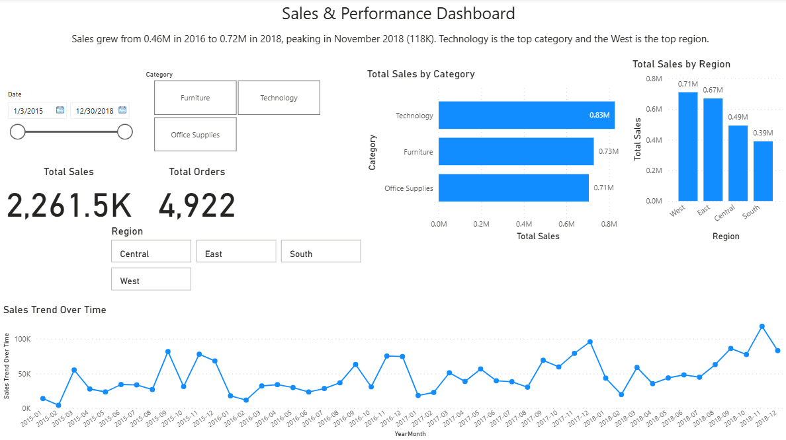

# Sales & Performance Dashboard (Power BI)

Interactive Power BI dashboard analysing sales data from 2015 to 2018 (4,922 orders, 2.26M total sales).

## What it shows
- Sales grew from 0.46M in 2016 to 0.72M in 2018, peaking in November 2018 (118K)
- Technology is the top category (0.83M)
- The West is the top region (0.71M)

## How it was built
- Power Query: cleaned and transformed the raw data, including setting date columns with an en-GB locale
- DAX: Total Sales and Total Orders measures, and a date table
- Slicers for date, category and region

## Data
Superstore Sales Dataset (Kaggle): https://www.kaggle.com/datasets/rohitsahoo/sales-forecasting
The data file is not included in this repo. See the Kaggle page for the file and its licence.

## Tools
Power BI Desktop, Power Query, DAX
